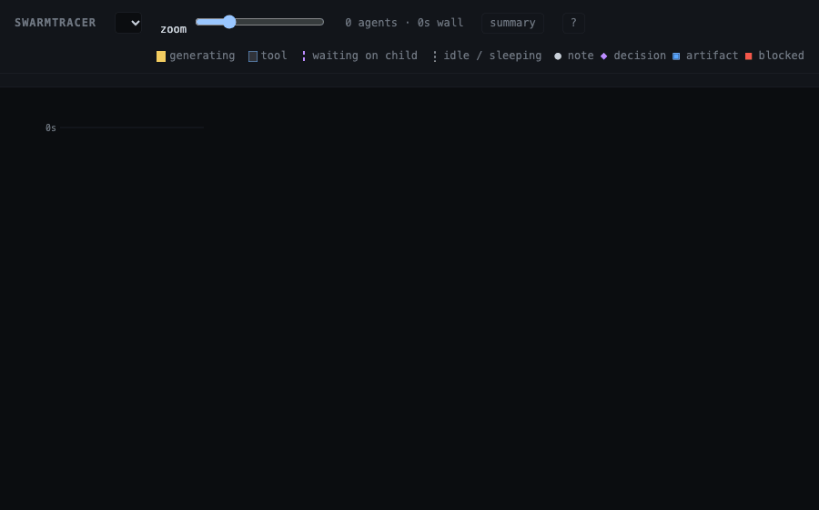

# SwarmTracer

**See what your Claude Code agents are doing, while they do it.**

When Claude Code fans work out to subagents, the terminal only shows you the parent. SwarmTracer draws every agent as a lane on a live timeline in your browser. Time flows down, lanes grow while agents work, and you can see at a glance who is thinking, who is running a tool, and who is waiting on whom.



*Above: an Opus session hands work to a Haiku scout and a Sonnet reader. Each running agent gets a robot at its lane's tip, and clicking a lane shows its task and what it handed back.*

## What you get

- **A lane per agent**, linked to the agent that spawned it, colored by what it's doing: generating, running a tool, waiting on a child, or idle.
- **A summary strip** with each agent's model, wall time, and time breakdown.
- **Click anything for details**: the task an agent was given, its result, the reasoning behind a segment, the exact tool call.
- **Annotations**: agents can drop notes, decisions, artifacts and "I'm blocked" markers on their own lane with the `atl` command.
- **Local only**: a small Node server on `127.0.0.1` fed by Claude Code hooks, with no account and no cloud service.

## Quick start

You need Node 22+ and Claude Code.

```sh
git clone https://github.com/gravitypersists/swarmtracer.git
npm install --prefix swarmtracer
claude --plugin-dir ./swarmtracer
```

Ask Claude to do something that uses subagents, and the timeline opens on its own when the first one spawns. To try it with no live session, run `npm start` and `npm run replay -- fixtures/m5-mixed-models.json` in the repo, then open http://127.0.0.1:47821. That replays the run in the GIF.

See `BRIEF.md` for the design and `docs/` for per-milestone notes and screenshots.

## Run it by hand

```sh
npm install
npm start            # builds the UI and serves http://127.0.0.1:47821
npm run seed         # optional: load the recorded fixture runs
```

`npm run dev` rebuilds the UI and restarts the server on change. Set `SWARMTRACER_PORT` to use another port; the hooks and `atl` read the same variable.

## Use it with Claude Code (plugin)

SwarmTracer is a Claude Code plugin. Once it's enabled, a session starts the SwarmTracer server if it isn't running, and opens the timeline in your browser the first time the session spawns a subagent. If a SwarmTracer tab is already open, it doesn't open another; the open page follows new runs. `atl` and `swarmtracer` are on the agents' PATH, and `/swarmtracer:open` opens the page on demand.

One-time setup:

```sh
npm install --prefix /path/to/swarmtracer
```

Then pick a scope:

```sh
# For one launch (e.g. alongside another plugin)
claude --plugin-dir /path/to/swarmtracer ...

# Everywhere, or for one project (run from that project for --scope project)
claude plugin marketplace add /path/to/swarmtracer
claude plugin install swarmtracer@swarmtracer-local --scope user      # or: project, local
```

Options are set in `/config` once the plugin is enabled:
- `open_browser`: `first subagent` (default), `session start`, or `never`.
- `window`: `app` (default) opens the page in its own 900×600 window without browser toolbars, using Chrome, Edge, Brave or another Chromium browser (a normal tab if there's none); `tab` always uses a tab.
- `annotate`: tell agents about `atl`; default on.

Plugins can't grant permissions. So that `atl` never stops for approval, allow `Bash(atl:*)` in your settings, or pass `--allowedTools "Bash(atl:*)"` for `claude -p` runs.

From a terminal: `bin/swarmtracer start | stop | status | open [run] [--app|--tab]`.

### Without the plugin

`node hooks/settings.mjs --annotate` prints a hooks block to merge into a project's `.claude/settings.json`. With that route, you start the server yourself (`npm start`) and put `bin/` on PATH for `atl`.

## Annotations

```sh
atl note "text"
atl decision "chose B" --why "A requires a migration"
atl artifact ./path/to/file ["what it is"]
atl blocked "waiting on API key from user"
```

## Using the page

- Click any segment, lane, marker or connector for details. Hover anything to see the events behind it.
- Keyboard: `↑↓`/`jk` segments, `←→`/`hl` lanes, `Enter` segment↔lane, `Esc` close, `g`/`G` start/live, `+`/`−` zoom, `s` summary, `?` help.
- Running agents get a robot at their lane's tip: headphones for Opus, a beret for Sonnet, a sprout for Haiku.

## Checks

- `npm test`: unit tests (layout against recorded runs, annotation matching).
- `npm run check:live`: replays a run into a fresh server and drives headless Chrome through the live view, panels and annotations.
- `npm run replay -- fixtures/<run>.json --speed 4`: watch a recorded run live, using no usage.

## License

MIT. See [LICENSE](LICENSE).
